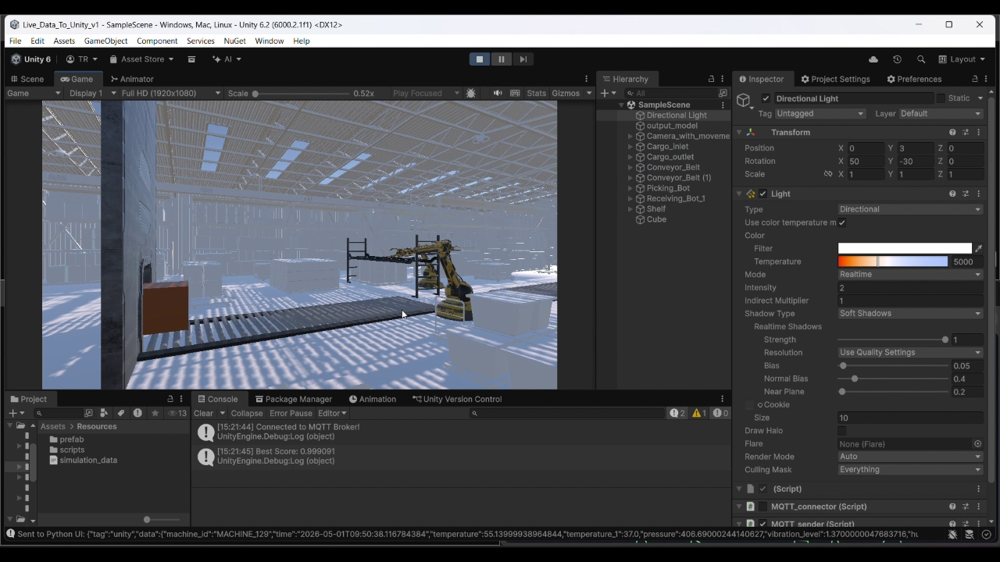
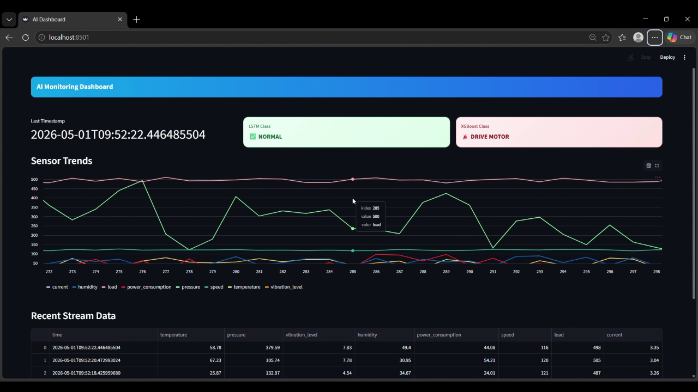
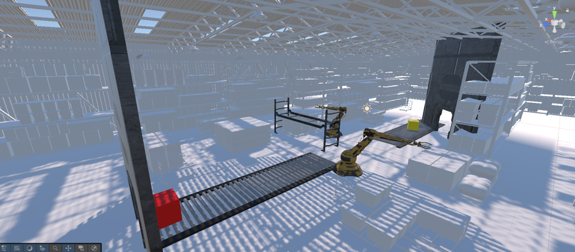
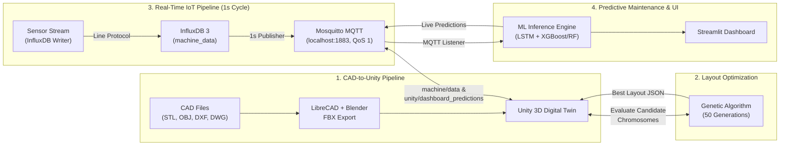

# Real-Time Digital Twin Platform for Predictive Maintenance & Layout Optimization

> **An end-to-end Industry 4.0 Digital Twin system** integrating **3D Unity factory simulation**, **Genetic Algorithm (GA) spatial layout optimization**, **real-time MQTT + InfluxDB 3 IoT telemetry**, **deep learning & ensemble predictive maintenance**, and a **live Streamlit monitoring dashboard**.

> **Repository Scope:** This public portfolio repository showcases the architecture, live system outputs, performance benchmarks, and demonstration media. Implementation source code and licensed 3D environment assets are kept in a private repository.

---

## Key Highlights & Measurable Outcomes

- **93% Machine Failure Prediction Accuracy** using a sliding-window **LSTM** model on multi-sensor time-series streams (outperforming a **GRU** baseline at 91% with lower inference latency for real-time deployment).
- **93% Multi-Class Conveyor Fault Classification Accuracy** across 6 fault categories using **Random Forest** with **SMOTE** oversampling (vs. 90% with **XGBoost**), reaching **1.00 F1-score** on Drive Motor faults and **0.99 F1-score** on Belt Slippage and Central Shaft faults.
- **Simulation-in-the-Loop Spatial Optimization** using a **Genetic Algorithm** inside Unity to optimize placement and orientation of robotic arms, conveyors, and storage shelves (`Population = 5`, `Generations = 50`, `Mutation Rate = 0.3`, `Tournament Selection k = 2`, `Uniform Crossover`).
- **1-Second End-to-End Telemetry Sync** across 8 concurrent operational metrics (`temperature`, `pressure`, `vibration`, `humidity`, `power consumption`, `speed`, `load`, `current`) via **InfluxDB 3** and **Mosquitto MQTT (QoS 1)**.
- **Automated CAD-to-Unity Pipeline** converting `STL`, `OBJ`, `DXF`, `DWG`, `DWT`, and `DWS` files to Unity-compatible FBX prefabs through a custom Blender + LibreCAD editor integration.

---

## Project Results & Demonstrations

### 1. Live Digital Twin & AI Monitoring Dashboard

The Unity 3D warehouse environment synchronizes live MQTT telemetry and applies the top-scoring GA-generated layout (`Best Score: 0.999091`), while the Streamlit dashboard streams real-time LSTM failure and conveyor fault predictions alongside live multi-sensor trends.

### 2. Automated CAD-to-Unity Warehouse Import

Industrial CAD models (`STL`, `OBJ`, `DXF`, `DWG`, `DWT`, `DWS`) are automatically converted to FBX and imported into Unity to construct the base 3D warehouse shell before equipment placement.

### 3. GA-Optimized Warehouse Layout

The Genetic Algorithm evaluates candidate factory floor arrangements inside Unity physics/process simulations and converges on a collision-free, high-efficiency configuration linking cargo inlets, conveyors, robotic arms, and storage shelves.

### 4. Output Demo Videos

| Demonstration | What It Shows | Video |
| :--- | :--- | :--- |
| **Live Data with AI UI** | 1-second InfluxDB 3 → MQTT → Unity synchronization with live ML inference and Streamlit dashboard updates | [▶ Watch `Live data with UI.mp4`](./output/Screen%20Recording/Live%20data%20with%20UI.mp4) |
| **GA Layout Optimization** | Genetic Algorithm iteratively placing and scoring factory components inside Unity across generations | [▶ Watch `GA optimizing Layout.mp4`](./output/Screen%20Recording/GA%20optimizing%20Layout.mp4) |
| **Final Optimized Layout** | Converged warehouse layout rendered in Unity with active material handling | [▶ Watch `final output GA optimized Layout.mp4`](./output/Screen%20Recording/final%20output%20GA%20optimized%20Layout.mp4) |

---

## System Architecture & Data Flow

The platform connects five subsystems in a closed-loop architecture spanning CAD ingestion, spatial optimization, IoT streaming, ML inference, and real-time visualization.

### CAD Ingestion, Telemetry & AI Pipelines

| Live Data Ingestion (`InfluxDB 3 → MQTT → Unity`) | AI Prediction Loop (`Unity → MQTT → ML → Dashboard`) |
| :---: | :---: |
|  |  |

### System Components

| Subsystem | Stack / Role | Responsibility |
| :--- | :--- | :--- |
| **CAD Ingestion Tool** | Blender, LibreCAD, Unity Editor Plugin | Automates `STL`/`OBJ`/`DXF` and `DWG`/`DWT`/`DWS` conversion into Unity `.fbx` assets. |
| **Layout Optimizer** | Genetic Algorithm, Unity C# | Evaluates spatial chromosomes `(Name, X, Z, Rotation)` inside Unity and applies the highest-scoring layout. |
| **Time-Series Storage** | Python, InfluxDB 3 | Normalizes incoming sensor streams and writes nanosecond-timestamped Line Protocol records (`machine_data`). |
| **Telemetry Broker** | Python, Mosquitto MQTT, Unity (`MQTTnet`) | Streams 1-second JSON telemetry and ML predictions across Unity and Python consumers (`QoS 1`). |
| **ML Inference Engine** | TensorFlow/Keras, XGBoost, scikit-learn | Runs sliding-window LSTM machine failure prediction and conveyor fault classification in real time. |
| **Monitoring Dashboard** | Streamlit | Auto-refreshing operational UI displaying live fault status cards, sensor trend charts, and stream logs. |

### MQTT Topics & Data Interfaces

| Interface / Topic | Flow | Purpose |
| :--- | :--- | :--- |
| `machine_data` (InfluxDB 3) | Ingestion → InfluxDB 3 | Time-series measurement tagged by `machine_id` storing normalized sensor fields at nanosecond precision. |
| `machine/data` (MQTT, QoS 1) | InfluxDB Publisher → Unity & ML | 1-second JSON telemetry stream consumed concurrently by the Unity digital twin and ML listener. |
| `unity/to/pythonui` (MQTT) | Unity → ML Listener | Tagged JSON payload streaming simulated machine metrics from the 3D environment. |
| `unity/dashboard_predictions` (MQTT) | ML Listener → Unity | Real-time prediction payload (`time`, `lstm_label`, `lstm_score`, `xgb_label`, `xgb_pred`) synced back to Unity. |

---

## Layout Optimization Model (Genetic Algorithm)

Each candidate factory layout is encoded as a chromosome of component genes:

$$\text{Gene}_i = (\text{Name}_i, X_i, Z_i, \theta_i), \quad \theta_i \in \{0^\circ, 90^\circ, 180^\circ, 270^\circ\}$$

Candidates are executed inside Unity and scored using a weighted composite fitness function:

$$\text{Fitness} = 0.35 \cdot \text{Efficiency} + 0.20 \cdot \text{Process} + 0.30 \cdot \text{Failure} + 0.15 \cdot \text{Coverage}$$

- **Efficiency & Process:** $1 - \frac{\text{TotalTime}}{\text{MaxTotalTime}}$ and $1 - \frac{\text{ProcessTime}}{\text{MaxProcessTime}}$
- **Failure:** Binary operational success indicator ($1$ if collision/fault-free, $0$ otherwise)
- **Coverage:** $\sqrt{\frac{\text{VisitedObjects}}{\text{TotalObjects}}}$

---

## AI Predictive Maintenance Results

### Machine Failure Prediction (Binary: LSTM vs. GRU)
Trained on **3,000 multi-sensor records** (`Temperature`, `Pressure`, `Vibration_Level`, `Humidity`, `Power_Consumption`) using sliding temporal windows (`Input → LSTM (64) → Dropout (0.2) → Dense (32, ReLU) → Dense (1, Sigmoid)`):

| Class | LSTM Precision | LSTM Recall | LSTM F1 | GRU Precision | GRU Recall | GRU F1 | Support |
| :--- | :---: | :---: | :---: | :---: | :---: | :---: | :---: |
| **No Failure (0)** | 0.95 | 0.96 | 0.96 | 0.93 | 0.94 | 0.94 | 600 |
| **Failure (1)** | 0.88 | 0.85 | 0.86 | 0.83 | 0.80 | 0.81 | 180 |
| **Overall Accuracy** | **93%** | — | — | **91%** | — | — | 780 |

### Conveyor Belt Fault Classification (6-Class: Random Forest vs. XGBoost)
Trained on **1,209 operational records** (`Speed`, `Load`, `Temperature`, `Vibration`, `Current`) with median imputation, `StandardScaler`, 80/20 stratified split, and **SMOTE** oversampling:

| Fault Class | Random Forest F1 | XGBoost F1 |
| :--- | :---: | :---: |
| **Normal** | 0.88 | 0.84 |
| **Belt Slippage** | 0.99 | 0.94 |
| **Central Shaft Fault** | 0.99 | 0.94 |
| **Drive Motor Fault** | 1.00 | 1.00 |
| **Idler Roller Fault** | 0.93 | 0.88 |
| **Pulley Fault** | 0.83 | 0.79 |
| **Overall Accuracy** | **93%** | **90%** |

| Random Forest Confusion Matrix | XGBoost Confusion Matrix |
| :---: | :---: |
|  |  |

---

## Tech Stack

| Layer | Technologies |
| :--- | :--- |
| **3D Simulation & Digital Twin** | Unity 3D, C#, MQTTnet, Newtonsoft.Json |
| **CAD Toolchain** | Blender (FBX export), LibreCAD (DWG/DWT/DWS → DXF), Python |
| **Optimization** | Genetic Algorithm (Tournament Selection, Uniform Crossover, Simulation-in-the-Loop Fitness) |
| **IoT & Time-Series Backend** | Python, Mosquitto MQTT (`paho-mqtt`), InfluxDB 3 |
| **Machine Learning & Deep Learning** | TensorFlow / Keras (LSTM, GRU), scikit-learn (Random Forest, StandardScaler, SMOTE), XGBoost, Pandas, NumPy, Joblib |
| **Visualization & Dashboard** | Streamlit |

---

## Engineering Scope & Future Roadmap

- **Current Scope:** Real-time telemetry sync and AI inference are validated using live dataset-driven sensor streams and a local single-node Mosquitto MQTT + InfluxDB 3 stack integrated with the Unity digital twin.
- **Future Extensions:** Connecting physical PLC/IIoT hardware sensors, enabling bidirectional control commands from the dashboard back to physical actuators, applying Reinforcement Learning for dynamic layout adaptation, and deploying quantized ML models for edge inference.

---

**Author:** Thanweer Ramzan
